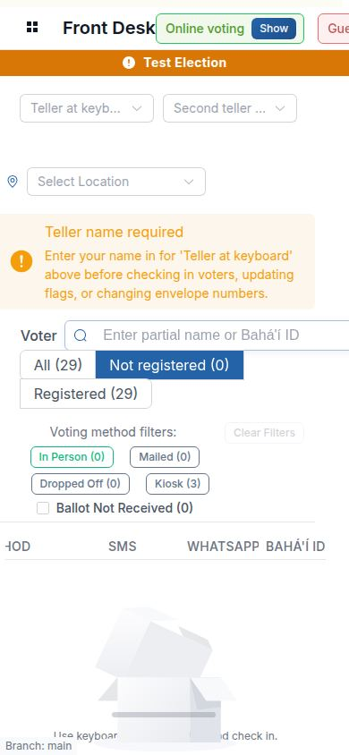
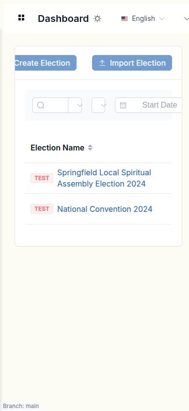
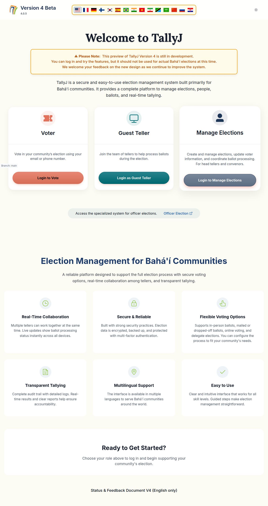
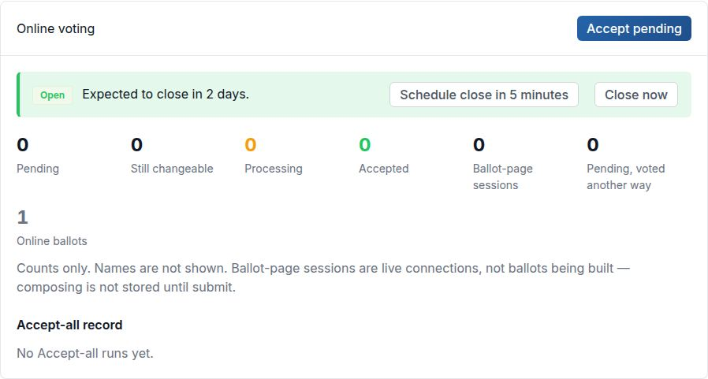
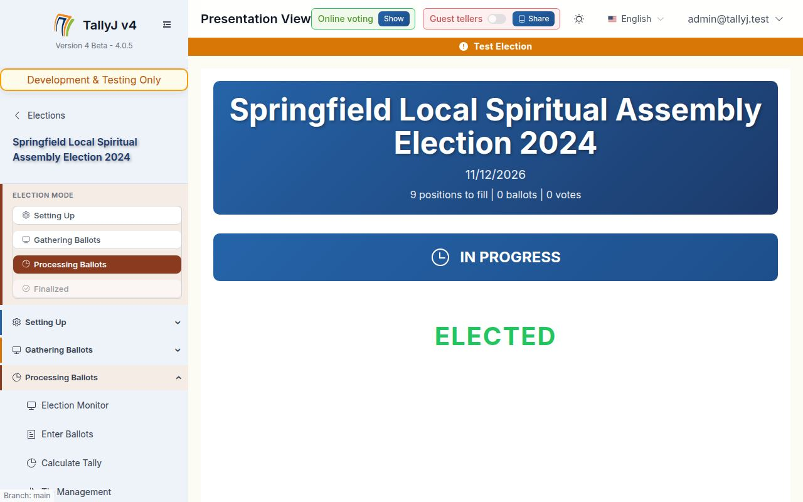
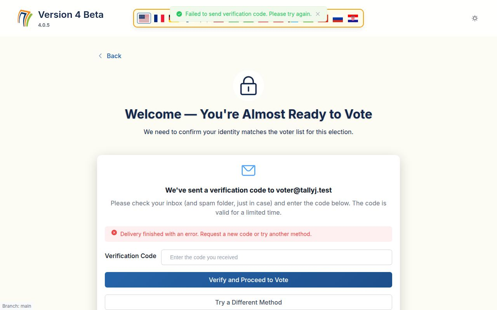
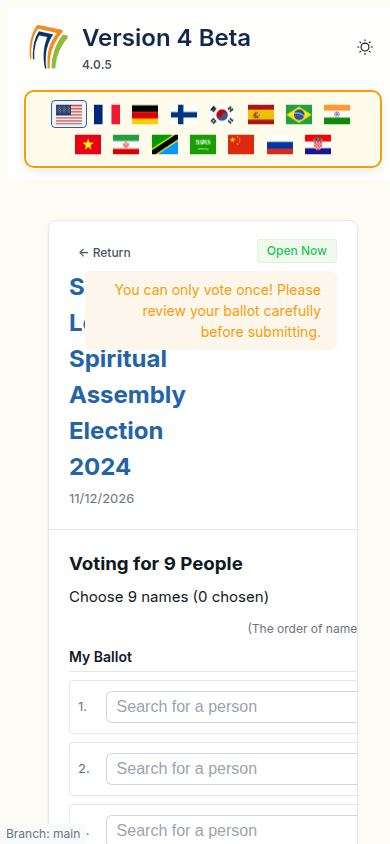

# UI critique — 15 November 2026

Designer pass for [#442](https://github.com/glittle/TallyJ-4/issues/442). This document is the critique and the slice list only. It does not change the app.

Screenshots live in [`docs/ui-critique-2026-11/`](ui-critique-2026-11/). Names are `{desktop|phone}-{light|dark}-{screen}.jpg`. Desktop is 1280×800. Phone is 390×844. A few desktop-light pages (landing, election edit, tally, results, presentation, reports) are full-page captures; the rest are the viewport.

## How this was reviewed

Local Development build, 15 November 2026. Backend on `http://localhost:5016` with `Database:SeedOnStartup`, SQL Server, and the seeded admin `admin@tallyj.test`. Frontend Vite at `https://localhost:8095`. The election in the teller shots is **Springfield Local Spiritual Assembly Election 2024** (stage Processing ballots, online voting on, marked test). The voter shots use `voter@tallyj.test` on that same election.

axe-core (WCAG 2.0/2.1 A and AA) ran on the desktop shots in both themes. Ratios quoted below were measured from the tokens or from those results.

Not reached as a finished flow, and called out where it matters:

- A completed tally. Calculate Tally refuses to run: Front Desk accounts 31 people and the ballot list has 20, and 2 ballots still have outstanding issues. Results, presentation, and tie management are the pre-tally screens.
- A report after one is chosen. Reports opens on the empty canvas.
- A successful email delivery. This machine has no SMTP, so `requestCode` returned `voting.auth.requestCode.sendFailed`. That is a local limitation, and it is also the copy the voter sees whenever sending fails.
- The Google button on voter sign-in. The Google tab rendered the error alert and no button. That can be this host's OAuth origin; the failure state is still what the page does.

[#443](https://github.com/glittle/TallyJ-4/issues/443) shipped in [#447](https://github.com/glittle/TallyJ-4/pull/447) while these shots were being taken: the `color-scheme` meta tag now follows the pinned light or dark theme. These pictures are the UI after CSS has loaded. They do not re-open that meta-tag work. Earlier contrast work in #285 (dark hairlines, link color, unselected stage chips, warning banners) is also left as settled. The contrast notes below are what still fails on top of that.

## Update — 16 November 2026

`main` moved after the screenshots. This pass was rebased onto that `main`. The pictures are still the 15 November build. The notes below say what those later changes already closed.

Glen's decisions on [#442](https://github.com/glittle/TallyJ-4/issues/442):

1. **Presentation is a projector.** Full screen. No teller menus, sidebar, or header chips.
2. **Front Desk opens on Everyone.** The Not registered filter stays available. It is not the first list.
3. **The monitor's 5-minute close shortcuts stay in production.** Schedule close in 5 minutes, Close now, and Open for 5 minutes are teller controls, not a test harness.

Already shipped, and not slices here:

- [#446](https://github.com/glittle/TallyJ-4/issues/446) is a behaviour-neutral naming and comment pass. No visual slice drops because of it.
- [#460](https://github.com/glittle/TallyJ-4/issues/460) / [#462](https://github.com/glittle/TallyJ-4/pull/462) map the presentation banner to the server's `Final` and `In Progress`. Colour, icon, and translated label for those two statuses are done. The projector chrome and the pre-tally zero counts are not.
- [#464](https://github.com/glittle/TallyJ-4/issues/464) / [#466](https://github.com/glittle/TallyJ-4/pull/466) make the super-admin status filter and tags use the real election stages. Slice 7 is still the teller election-details codes (`ProcessingBallots`, `LSA`, `N`).
- [#468](https://github.com/glittle/TallyJ-4/issues/468), [#469](https://github.com/glittle/TallyJ-4/issues/469), and [#471](https://github.com/glittle/TallyJ-4/pull/471) make dashboard and super-admin counts follow stage, and make monitor refresh record contact and apply `MonitorUpdated`. Slice 5 is still the status column wrapping mid-word and the phone toolbar.

Leave these alone. They are open product questions outside this list:

- [#453](https://github.com/glittle/TallyJ-4/issues/453) — online voting window rules differ by sign-in path. Do not edit that window code from a UI slice.
- [#470](https://github.com/glittle/TallyJ-4/issues/470) — setup-step defaults, whether area turnout counts paper ballots, and which flag means "online voting enabled".

## Overall

The public site and the teller app are two different products that share a logo.

The landing page, officer sign-in, and voter sign-in are a composed marketing/auth surface: cream page (`#FDFCF4`), a centered card, Lora on the welcome heading, and three role cards. That layer is the closest thing the app has to a designed first impression. Its problems are contrast on the voter button, a flag strip that consumes the top of every public page, and a voter path that can tell three different stories about the same code.

The teller app is a capable Element Plus workspace: 300px sidebar, 60px header, cream canvas, cards, and tables. The information is there. The hierarchy is flat. The same four stages appear twice in the sidebar. The header tries to hold the page title, online-voting status, guest-teller status, theme, language, and the account on one row, and at 1280px that row is already colliding. At 390px the row clips and the tables keep their desktop columns. Empty states use the stock open-box illustration and the words "No data", including when the data is merely filtered out.

Dark mode is real, not a filter. The navy sidebar, cream-to-navy page, and token flip hold together on the dashboard and the monitor. What is left is small text still painted with light-theme gray, a selected stage chip whose dark fill is too light for white type, and empty-state art that stays white.

## Cross-cutting

### The election header does not fit

On every election page the title and the status chips share one 60px row (`AppHeader`).

At 1280px, "People Management" runs into the Online voting chip. At 390px the title truncates (`Presentati…`), the Online voting chip covers the title on Front Desk, and Guest tellers is cut to `Gue` or `Sho`. The test-election bar then takes another full row, so the work area starts lower than the layout budget assumes.

**Fix:** Let the header wrap under about 1100px, or move Online voting and Guest tellers into a second bar under the title. Keep the page title on one line. The chips are status, not navigation, and they should not compete with the title for the same 200px.

### The sidebar says the stage twice

Election mode is a vertical radio group (Setting up, Gathering ballots, Processing ballots, Finalized). Under it, the same four stages are accordions of pages. Both are useful jobs — one changes the stage, one navigates — and stacked they read as two menus. The mode group also uses a lot of the 300px column before the page the teller came to do.

**Fix:** Keep the radios as the stage switch and style them as one compact control. Let the accordion be only the pages for the current stage, with the other stages collapsed to a single row. That is one sidebar change, not a new navigation model.

### Tables and toolbars assume a wide window

Dashboard status wraps to `Processin` / `g Ballots` while the card still has empty space on the right, because the status column is narrower than the phrase. On a phone the dashboard drops every column except the name, clips **Create Election** off the left edge, and lets the filter row scroll sideways with no hint. Front Desk keeps IE, method, SMS, WhatsApp, Bahá'í ID, area, and when on one row, so the phone view is a slice of the desktop table. Ballot entry's two columns stack, and the names already on the ballot fall below the fold; the teller dropdowns shrink to `T.` and `S.`

**Fix, per screen, not one giant responsive rewrite:** give Status `min-width` and let the name wrap; under 768px turn the dashboard filters into a single search plus a "Filters" disclosure; on Front Desk and ballots, card the row or allow a declared horizontal scroll with the first column stuck. Ballot entry on a phone should show the name list above the search, because that is the work product.

### Empty states name the component, not the situation

The stock box plus "No data" appears when Front Desk's default filter matches nobody, and tie management uses the same box for "No ties require management" while **Save changes** stays a primary button. Reports says "Please select a report…" beside a list of twenty reports. Presentation says **ELECTED** in green with no names under it, and the banner says `0 ballots | 0 votes` on an election whose monitor shows 20 ballots and 76 votes.

**Fix:** Each empty state should say what is true and what to do next. Front Desk: "No one is waiting under Not registered. 29 people are registered." Ties: "Ties show up here after a tally" and hide Save. Presentation: "No tally yet" rather than a zero that contradicts the monitor. Reports: select the first report, or show its name in the placeholder.

### Copy still has developer strings

Election details shows status `ProcessingBallots`, type `LSA`, and mode `N`. The edit form next door says "Local Spiritual Assembly" and "Normal election". Tally and results say `1 mismatch(es)` and `2 ballot(s)`. The manual-count placeholder "Use calculated" is clipped to "Use calcu" inside the input.

**Fix:** Use the same stage and type labels the edit form already has. Use vue-i18n plural forms (`1 mismatch` / `2 mismatches`). Put "Use calculated" on a button or a shorter placeholder (`Auto`).

### Colour and contrast that still fail

Measured, not guessed:

| Where | Pair | Ratio | What to change |
| --- | --- | --- | --- |
| Sidebar version line and the "Election mode" label | `#6b7280` on `#eef2f9` | 4.3:1 | Use `--color-gray-600` (`#4b5563`) on the light sidebar. The label is 11px, so it needs 4.5:1, not the large-text bar. |
| Same version line in dark | `#6b7280` on `#0e2040` | 3.3:1 | The class sets `color: var(--color-gray-500)` in both themes. Point it at `--color-sidebar-text`. |
| Dark selected "Processing ballots" | white on `#c2643c` (`--color-stage-process`) | 4.1:1 | Darken the dark-theme process fill. White-on-fill is already the rule; the fill is the part that is short. Light mode's `#8a3a1f` is 7.8:1 and is fine. |
| Landing "Login to Vote" | white on `#E2725B` | 3.1:1 | Move the voter accent to a darker coral, or use navy text on a tint. 16px semibold is not large text. |
| Feature icons on the landing | `#8DC63F` on `#FDFCF4` | 2.0:1 | Decorative next to a heading, so this is secondary. If the icon is the only marker, it fails the 3:1 UI-component bar. |
| Voter "Open now" tag and the pale welcome alert | axe `color-contrast` on `.el-tag__content` and `.el-alert__description` | serious | The success tag is a light green on a lighter green. Use the success text token on the success-50 surface, and darken the welcome paragraph (it is the only instruction on that card). |
| Success toast "Failed to send…" | axe on `.el-message__content` | serious | The string is a failure painted as a success toast. Fix the severity (below); the green-on-pale pair goes away with it. |

`--el-color-primary` stays `#2563a8` in both themes on purpose, so solid buttons do not shift. Do not "fix" dark links by changing that token. Name links already use `--color-text-link`.

### Accessibility that repeats on every election page

axe, desktop, both themes:

- **Critical.** `.stage-group__page` is `role="menuitem"` and its parent is not a `menu` or `menubar`. Six nodes on every election page. Give the group `role="menu"`, or drop `menuitem` and use links.
- **Serious.** The account button's accessible name is "User account menu" while the visible name is the email. They need to match, or the email should be the name and "Account menu" the description.
- **Critical.** People-table checkboxes and several Element Plus selects have no accessible name (`label`).
- **Critical.** Each voter "Search for a person" input sets `aria-controls` to an empty id (`aria-valid-attr-value`, nine fields).

The skip link on the teller shell is the right pattern. Keep it.

### What is already working

- Landing composition: one heading, one warning, three choices, then the feature grid. The warning uses warning-700 on warning-50, which clears AA.
- Officer sign-in is a single card, labels above fields, and empty submit shows "Email is required" / "Password is required" on the fields.
- Monitor stat cards (ballots, votes, computers, locations) are the clearest hierarchy in the teller app.
- Ballot status tags ("Too few", "Duplicate") scan without reading the whole row.
- Dark mode on the dashboard is coherent: navy sidebar, dark cards, readable body text, active item in blue with light type.
- Tokens exist (`tokens.less`, `tokens-dark.less`) and most new chrome uses them. The leftovers are hardcoded landing accents and `gray-500` used as if it were a semantic muted color.

## Screen notes

### Landing and sign-in

The flag strip is the first thing on the page, in a gold box, and on a phone it wraps to two rows before the heading. `PublicLayout` already has a compact `LanguageSelector`, and `expandLanguageSelector` is hard-coded `true`, so the flags show on every public route including the ballot.

The three role buttons use `#E2725B`, `#006D77`, and `#1D3557`. Those are not the logo navy, orange, and green (`#2563a8`, `#f47920`, `#8dc63f`). Teal and navy clear contrast. The coral voter button does not (3.1:1). All six feature icons are the same green, so colour is not carrying meaning there.

"Ready to get started?" repeats the cards and has no button. The status-document link is hardcoded English in the template, outside `$t()`.

The cards are clickable and contain a button, so a keyboard user gets two stops per card. The heading shadow on "Welcome to TallyJ" is light enough to leave; it is not doing useful work.

Officer sign-in is in good shape. "Forgot password?" is black and underlined; "Register" is a blue link. One link style is enough. On a 390×844 phone the Login button sits on the bottom edge of the first screen because the flag box pushed the card down.

The theme control shows a sun in light mode and a moon in dark mode, so the icon describes the current theme. The accessible name is "toggle theme", which is correct for a screen reader and ambiguous for the eye. A sun-and-moon pair, or a label, would match the name.

### Dashboard

Two elections, both badged TEST. The toolbar (Refresh, Create, Import) is clear. The filter row is five controls of equal weight, and the date range says "Start Date to End Date" with a stray "to". Status text wraps inside the column. The page has no empty-state shot because the seed always has rows; a zero-election dashboard is still worth a later look.

The "Development & testing only" pill in the sidebar and the orange test bar on election pages are both justified. They are also both on screen once an election is open. That is noisy and it is honest. Leave both until the product is not a preview.

### Election setup

Details, edit, people, locations, and tellers are the setup stage.

Details repeats the header title as the card title "Election details", then a two-column definition list with the raw codes above. Statistics (29 / 20 / 3) are the useful part and they sit in the same visual weight as the code table. Danger zone starts at the bottom of the viewport; that is acceptable if the destructive action stays visually separate, which the red label does.

Edit is a tabbed form. "Display & Priv…" is cut off on the tab strip at 1280px. Editable fields (name, date) and locked fields (type, mode) share one gray panel, so the lock helper text is the only signal that type cannot change. Save and Cancel are centered under the panel, then "Election admins" follows with no separation stronger than a heading.

People is the densest toolbar in the app: search, two "All" dropdowns, Add person, Import, four send actions, an email filter, "Retry failed", and **Delete all people** as a pink text button on the same row as send. Delete-all is a different kind of action and should not sit in the send cluster. Emails truncate (`daniel.brown0@test.c…`) with the row still having empty phone and SMS columns. Eligibility is a green check with no text; a screen reader gets the checkbox (itself unlabeled) and not "eligible".

Locations and tellers follow the same card-and-table pattern as details. No separate visual system. They inherit the header and sidebar issues and do not add new ones.

### Front desk

The 15 November build defaulted the registration filter to `notRegistered` (`useFrontDeskVoters.ts`). On this election that count is 0 and Registered is 29, so the first view is an empty table and a keyboard hint ("Use keyboard to navigate and check in") under a box that says "No data". The warning "Teller name required" is the right kind of empty-state writing. The table is not. Glen's decision (16 November) is that the first view is Everyone. A stored per-election choice can still restore Not registered. When a filter really matches nobody, the empty copy should name that filter.

The dev branch badge (`Branch: main`, fixed to the bottom-left corner) sits on that keyboard hint at 390px. The badge is an existing dev mark. It needs a few pixels of clearance, or the hint needs to clear it.

Method filters (In person 0, Mailed 0, Dropped off 0, Kiosk 3) are a second filter layer under the registration filter. Stacking both without saying they combine is how a teller ends up believing the room is empty.

### Ballot list and ballot entry

The list is one of the better tables: code, location, and a status tag. The toolbar still repeats "teller at keyboard" and "second teller" that ballot entry shows again inside the ballot card. On the entry page those dropdowns appear twice — once in the card header, once in the Teller 1 / Teller 2 grid — and a warning tells the teller to use the first pair. One control, next to the warning.

Names already entered are green rows. That reads as "accepted", which matches the data. The search column on a phone is the whole viewport; the name list is the thing the teller is building and it is off-screen.

### Monitor, tally, results, ties

The top of the monitor (four stat cards, method counts, computers) is the layout to copy elsewhere: number, then a short label, then a table.

Online voting is below that, easy to miss. The panel itself is clear: Open, expected close, six counts, a one-line explanation that names are hidden. Two gaps:

- Six zeros, then a separate **1** "Online ballots". The 1 is not in any of the six buckets, so the row and the total disagree on a quick read.
- **Schedule close in 5 minutes** and **Close now** have the same button weight. Close now ends voting. It should be the danger button. The 5-minute shortcuts stay in production (decided 16 November). Do not change how the window opens or closes ([#453](https://github.com/glittle/TallyJ-4/issues/453), [#470](https://github.com/glittle/TallyJ-4/issues/470)).

Tally leads with the reconciliation that is blocking the run. That is the right lead. The grammar (`mismatch(es)`) and the clipped "Use calcu" placeholder undercut it. "Spoiled ballots (included in entered)" equals "Ballots entered" (both 20) while Front Desk says 31. A teller cannot tell from the labels whether spoiled is a subset or a second name for the same count. The labels need a worked example in the helper text, or the spoiled figure needs to be a subset line rather than a peer of the entered total.

Results shows the same reconciliation card and then `2 ballot(s) have outstanding issues`, and nothing that looks like an outcome. Sharing the blocker with Tally is reasonable. The page title is "Election results", so the next line after the blocker should be "Results appear here after the tally runs", not more empty canvas.

Tie management's empty copy is the best of the three ("No ties require management"). **Save changes** as a primary button above that box says there is something to save.

### Presentation

The blue title band and the status band are the right idea for a room. They sit inside the teller sidebar, the dev pill, the test bar, and the overflowing header. On a phone the title is `Presentati…` and the banner wraps the election name into a square. `0 ballots | 0 votes` is what this page shows before a tally, while the monitor on the same election shows 20 and 76. A projector view that can be wrong by that much will get read aloud.

**Decided:** this page is the projector. Full screen, no teller menus. [#460](https://github.com/glittle/TallyJ-4/issues/460) / [#462](https://github.com/glittle/TallyJ-4/pull/462) already map `Final` and `In Progress` onto the green and orange banners. What is left is hiding the teller chrome, and saying the tally has not been run instead of a zero that contradicts the monitor.

### Reports

Three columns: app sidebar, report names, empty canvas. The names are plain text, grouped under Ballot reports and Voter reports, with no description and no selected state because nothing is selected. "Please select a report…" is centered in a large blank card.

**Fix:** Select a default report, or make the names buttons with a one-line description. The canvas can keep its size. The first click should not be required to learn that the list is clickable.

### Voter sign-in, elections, and the ballot

This is the sharpest bug in the pass. After "Send verification code" the page shows all of these at once:

1. A green success toast: "Failed to send verification code. Please try again." It covers the flag strip. `handleRequestEmailCode` always calls `showSuccessMessage(t(messageKey))`, and the key this time was `voting.auth.requestCode.sendFailed`.
2. The verify heading: "We've sent a verification code to voter@tallyj.test."
3. A red alert: "Delivery finished with an error. Request a new code or try another method."

The red alert is the truthful one. The toast uses the failure string and the success colour. The heading assumes success. A voter who can read all three will not know whether to check mail.

The Google tab is the default. On this run it showed the warning "An error occurred while processing your Google authentication" and no Google button, before a click. If that is only this machine's origin, the page still has a hole: the error replaces the button, so the default tab has no action. Email, phone, and code are tabs the voter has to discover.

The elections list, after a code that did verify, is one row with **Prepare my ballot**. The welcome alert is a long pale paragraph (axe contrast). "Registered: -" looks like a missing value. The failure toast is still on screen here, so the voter who just got in is told the send failed.

`VoterBallotPage` has no `@media` rules. The header is a row: title on the left, a 340px column on the right for the Open now tag and the "you can only vote once" alert. At 390px that row crushes the title into a few characters wide and the alert paints over it. The "order of names does not matter" note is clipped. Nine search fields then run down the page; rows 7–9 start below the fold, which is fine, the overlap is not.

**Fix:** Under 600px, stack the title, then the tag, then the alert, full width. Do not use a side column.

The public header (logo, two rows of flags, theme) sits above the ballot on a phone, so the first screen is chrome plus a broken title. Flags on the ballot are how a voter changes language, and they do not need to be the largest control on the page. The compact selector is already in the layout.

## Prioritized slices

Each row is meant to be one PR. S is a component or a token. M is one screen's layout or the shared header. L is still one PR, and it is the one that needs a design choice before code. Nothing here repeats the `color-scheme` meta tag from #443 / #447.

| # | Slice | Effort | Product decision |
| --- | --- | --- | --- |
| 1 | Voter code result: error toast when send fails, and do not say "We've sent" in that case. Stop the toast covering the flags. | S | No |
| 2 | Voter ballot under 600px: stack the title and the once-only warning. `VoterBallotPage.vue` only. | S | No |
| 3 | Election header: title on its own line; Online voting and Guest tellers wrap or move to a second bar. Fixes the collision on People, Front Desk, Ballot entry, and Presentation. | M | No |
| 4 | Front Desk opens on Everyone for a fresh browser. A stored per-election filter still wins. Empty copy names the active filter when that filter matches nobody. | S | Decided 16 Nov: Everyone first. |
| 5 | Dashboard columns and the phone toolbar: Status must not wrap mid-word; Create Election stays on screen; filters collapse under 768px. | M | No |
| 6 | Contrast leftovers: sidebar version and "Election mode" off `gray-500`; darken dark `--color-stage-process` so white type clears 4.5:1; darken the landing voter button; fix the voter "Open now" tag and the pale welcome alert. | S | Landing voter colour: darker coral, or navy text on a tint? |
| 7 | Human labels on election details (`Processing ballots`, `Normal`, full type name) and real plurals on tally/results (`1 mismatch`, `2 ballots`). Widen or shorten the "Use calculated" placeholder. | S | No |
| 8 | Presentation is full screen for a projector: hide the teller sidebar and header. Say the tally has not been run instead of `0 ballots`. Banner colour for `Final` / `In Progress` already shipped in #460 / #462. | M | Decided 16 Nov: projector, no teller menus. |
| 9 | People actions: move "Delete all people" out of the send row into a separate danger menu. | S | No |
| 10 | Ballot entry: one teller-at-keyboard control, not the toolbar pair plus the Teller 1 / Teller 2 grid. On a phone, show names already entered before the search. | S | Which teller control stays, the toolbar or the grid? |
| 11 | Tie page: hide Save when there is nothing to save, and say that ties appear after a tally. Reports: select a default report or make the list obviously clickable. | S | No |
| 12 | Public flags: use the compact language selector under 600px so landing, sign-in, and the ballot are not led by two rows of flags. | S | No. The full flag box can stay on the desktop landing. |
| 13 | Monitor online panel: explain the "1 online ballots" figure against the six zeros. Make Close now a danger button. Leave the 5-minute shortcuts, and do not edit the online-voting window (#453, #470). | S | Decided 16 Nov: the shortcuts stay in production. |
| 14 | Sidebar: stage radios stay the switch; accordions show the current stage's pages, with other stages collapsed. | M | Confirm the radios are the stage change and the accordions are only navigation. |
| 15 | axe roles: menu parent for stage links, names on people checkboxes, account button name matches the email, voter search `aria-controls` only when the list exists. | M | No |
| 16 | Dark empty illustration: the open-box graphic on Front Desk and Tie management stays white on navy. Recolour or use a token-coloured empty state. | S | No |
| 17 | Officer sign-in link styles (forgot password vs register) and a few pixels so Login is not on the phone fold. Landing: one link style on the status document, and put that string in the English catalog. | S | No |

Suggested order, after the 16 November decisions and the slices already shipped:

1. Voter code copy (slice 1). Sharpest bug. No product question left.
2. Voter ballot under 600px (slice 2).
3. Election header wrap (slice 3).
4. Front Desk Everyone default and empty copy (slice 4). The default is decided.
5. Dashboard column and phone toolbar (slice 5). Counts and monitor refresh are already fixed.
6. Human labels and plurals (slice 7). Super-admin stage tags are already fixed.
7. Presentation projector chrome (slice 8). The audience is decided. Banner status mapping is already fixed.
8. People "Delete all" (slice 9), tie/report empty actions (slice 11), compact public flags (slice 12), dark empty art (slice 16), officer sign-in links (slice 17).
9. Monitor panel copy and Close now weight (slice 13), without touching the voting window.
10. axe names and roles (slice 15).

Still waiting on a product choice, so not in that order: landing voter colour (slice 6), which ballot-entry teller control stays (slice 10), and whether the stage radios are the only stage switch (slice 14).

## Screenshot index

Public: `landing`, `sign-in`, `sign-in-validation` (light only), `voter-auth`, `voter-auth-email`, `voter-verify`, `voter-elections`, `voter-ballot`, `not-found` (desktop light).

Teller: `dashboard`, `election-setup`, `election-edit`, `people`, `locations`, `tellers`, `front-desk`, `ballots`, `ballot-entry`, `monitor`, `monitor-online` (light desktop, light phone, dark desktop), `tally`, `results`, `tie-management`, `presentation`, `reports`, `election-missing` (desktop light).

Each of those except the ones named above exists as desktop and phone, light and dark.
